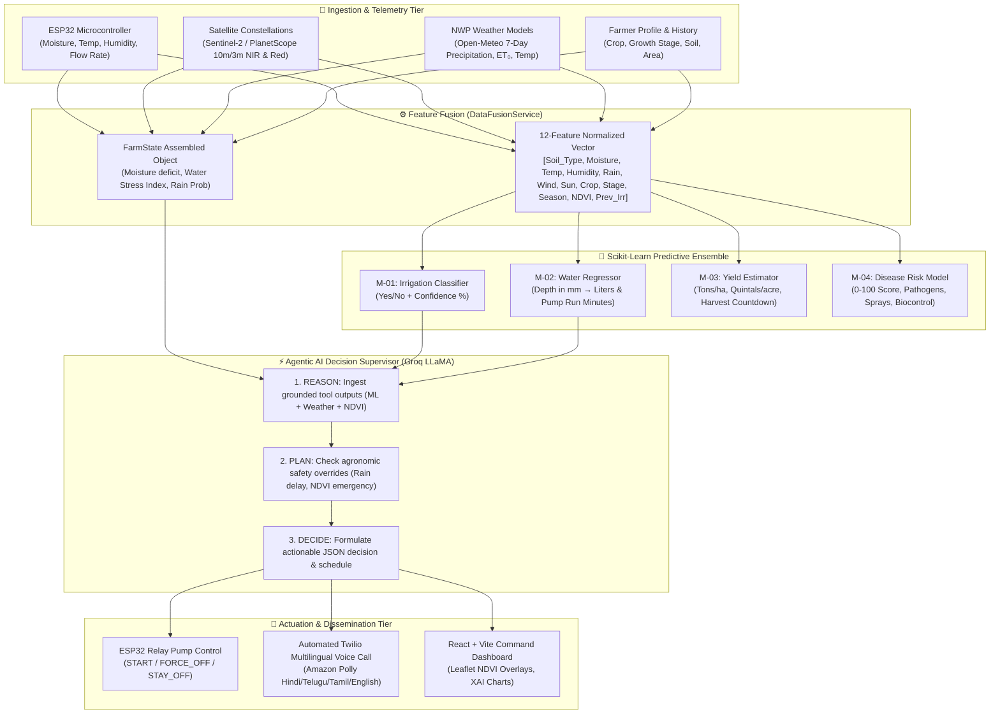
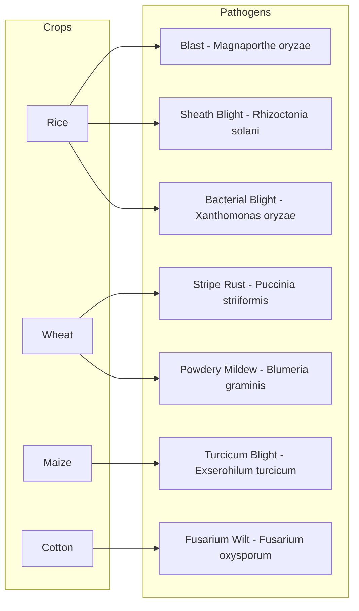
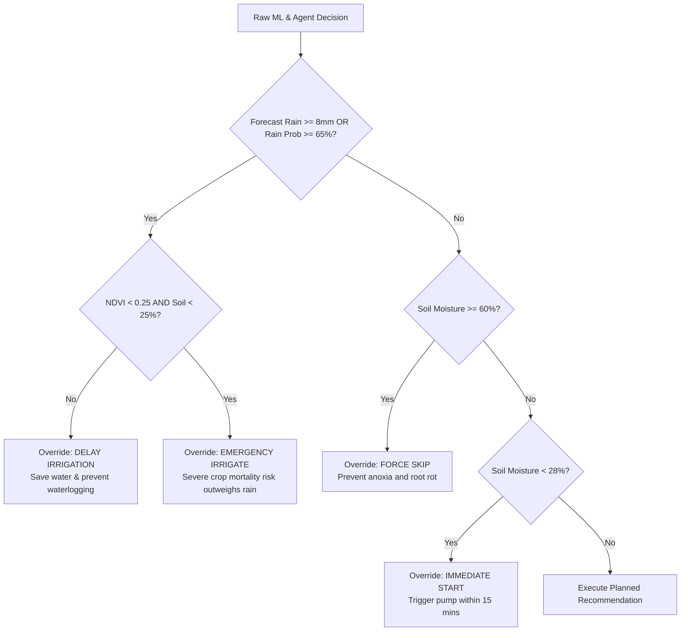

# 🧠 AgriMate AI/ML Models Knowledge Base (KB)

> **Comprehensive Technical Reference for all Machine Learning, Deep Learning, Large Language Models (LLMs), Remote Sensing, and Speech AI Engines deployed in AgriMate.**

---

## 📑 Table of Contents

1. [Executive Overview & Taxonomy](#1-executive-overview--taxonomy)
2. [End-to-End Multi-Model Architecture](#2-end-to-end-multi-model-architecture)
3. [Model 1: Smart Irrigation Binary Classifier](#3-model-1-smart-irrigation-binary-classifier)
4. [Model 2: Crop Water Requirement Regressor](#4-model-2-crop-water-requirement-regressor)
5. [Model 3: Crop Yield & Harvest Outlook Estimator](#5-model-3-crop-yield--harvest-outlook-estimator)
6. [Model 4: Crop Disease & Pathogen Risk Estimator](#6-model-4-crop-disease--pathogen-risk-estimator)
7. [Model 5: Groq LLaMA 3.3 70B Schedule Advisor](#7-model-5-groq-llama-33-70b-schedule-advisor)
8. [Model 6: Groq LLaMA 3.1 8B Agentic Decision Engine](#8-model-6-groq-llama-31-8b-agentic-decision-engine)
9. [Model 7: Multi-Lingual Speech & Voice AI Stack](#9-model-7-multi-lingual-speech--voice-ai-stack)
10. [Model 8: Satellite Earth Observation & NDVI Pipeline](#10-model-8-satellite-earth-observation--ndvi-pipeline)
11. [Model 9: Evapotranspiration ($ET_0$) Microclimate Engine](#11-model-9-evapotranspiration-et_0-microclimate-engine)
12. [Multi-Source Data Fusion & Safety Overrides](#12-multi-source-data-fusion--safety-overrides)
13. [API Endpoints & Integration Map](#13-api-endpoints--integration-map)
14. [Retraining & Operational Maintenance Guide](#14-retraining--operational-maintenance-guide)

---

## 1. Executive Overview & Taxonomy

AgriMate employs a **hybrid AI ecosystem** that fuses deterministic physics-based models, discriminative machine learning algorithms, remote sensing satellite spectral processing, generative foundation LLMs, and conversational speech interfaces:

| Model ID | Model Name | Category | Primary Technology | Artifact Location / Provider |
| :--- | :--- | :--- | :--- | :--- |
| **M-01** | **Irrigation Classifier** | Tabular ML (Binary Classification) | Scikit-Learn `RandomForestClassifier` | `iot/ml_model/saved_models/irrigation_model.pkl` |
| **M-02** | **Water Requirement Regressor** | Tabular ML (Continuous Regression) | Scikit-Learn `RandomForestRegressor` | `iot/ml_model/saved_models/water_requirement_model.pkl` |
| **M-03** | **Crop Yield Estimator** | Agronomic ML (Multi-output Regression) | Scikit-Learn `RandomForestRegressor` | `iot/ml_model/saved_models/yield_model.pkl` |
| **M-04** | **Crop Disease & Pathogen Risk** | Epidemiological ML (Risk Scoring) | Scikit-Learn `RandomForestRegressor` + Agro KB | `iot/ml_model/saved_models/disease_model.pkl` |
| **M-05** | **7-Day Schedule Advisor** | Generative LLM (Calendar Planning) | Meta LLaMA 3.3 70B (`llama-3.3-70b-versatile`) | Groq Cloud LPU Engine |
| **M-06** | **Agentic Decision Engine** | Agentic Reasoning (REASON-PLAN-DECIDE) | Meta LLaMA 3.1 8B (`llama-3.1-8b-instant`) | Groq Cloud LPU Engine |
| **M-07** | **Voice & Speech AI** | Speech-to-Text (ASR) & Text-to-Speech (TTS) | Twilio Speech Recognition + Amazon Polly Neural | Twilio Voice Cloud |
| **M-08** | **Satellite NDVI Spectral Model** | Radiative Remote Sensing | Sentinel-2 MSI (10m) / PlanetScope (3m) | Google Earth Engine / Planet Labs API |
| **M-09** | **ET₀ Evapotranspiration Physics** | Microclimate Physics | FAO-56 Penman-Monteith Numerical Model | Open-Meteo NWP Forecast Data |

---

## 2. End-to-End Multi-Model Architecture



---

## 3. Model 1: Smart Irrigation Binary Classifier

### 3.1 Overview
- **Model Identifier**: `M-01`
- **File Artifact**: `iot/ml_model/saved_models/irrigation_model.pkl` (Fallback: `irrigation_model(1).pkl`)
- **Training Script**: `iot/ml_model/train_comprehensive.py`
- **Inference Service**: `iot/backend/app/services/prediction.py` (`predict_irrigation_need()`)
- **Algorithm**: `RandomForestClassifier` (Ensemble of 100 Decision Trees)
- **Framework**: `scikit-learn >= 1.3.0`, serialized with `joblib`

### 3.2 Hyperparameters & Configuration
```python
RandomForestClassifier(
    n_estimators=100,
    random_state=42,
    criterion='gini',
    max_depth=None,
    min_samples_split=2,
    min_samples_leaf=1,
    bootstrap=True
)
```

### 3.3 Input Features Specification (12 Features)
| Feature Name | Type | Range / Categories | Description |
| :--- | :--- | :--- | :--- |
| `Soil_Type` | Integer | `0`: Sandy, `1`: Loamy, `2`: Clay | Soil mechanical texture & water retention capacity |
| `Soil_Moisture` | Float | `0.0` to `100.0` (%) | Real-time volumetric moisture from capacitive probe |
| `Temperature_C`| Float | `10.0` to `50.0` (°C) | Ambient field temperature (DHT11 or weather station) |
| `Humidity` | Float | `10.0` to `100.0` (%) | Relative ambient humidity |
| `Rainfall_mm` | Float | `0.0` to `50.0` (mm) | 24-hour recorded or forecast rainfall |
| `Wind_Speed_kmh`| Float | `0.0` to `60.0` (km/h) | Wind speed affecting boundary layer conductance |
| `Sunlight_Hours`| Float | `0.0` to `14.0` (hrs) | Daily photoperiod duration |
| `Crop_Type` | Integer | `0`: Rice, `1`: Wheat, `2`: Maize, `3`: Cotton, `4`: Pulse, `5`: Sugarcane | Cultivated crop cultivar |
| `Crop_Growth_Stage`| Integer | `0`: Initial, `1`: Vegetative, `2`: Flowering/Heading, `3`: Maturity | Crop phenological development stage |
| `Season` | Integer | `0`: Kharif (Monsoon), `1`: Rabi (Winter), `2`: Zaid (Summer) | Cropping calendar season |
| `NDVI` | Float | `-0.2` to `1.0` | Normalized Difference Vegetation Index from Sentinel-2 |
| `Previous_Irrigation_mm`| Float | `0.0` to `60.0` (mm) | Water delivered in prior 72 hours |

### 3.4 Target Variable & Ground-Truth Agronomic Rules
- **Target**: `Irrigation_Needed` (`int` $\in \{0, 1\}$)
- **Synthetic Ground Truth Derivation**:
  $$\text{Deficit} = \max(0, 60.0 - \text{Soil\_Moisture})$$
  $$\text{Factor}_{ET_0} = \text{clip}\left(1.0 + (\text{Temp} - 25) \times 0.02 + (\text{Sun} - 8) \times 0.03 + (\text{Wind} - 10) \times 0.01 - (\text{Humidity} - 60) \times 0.008, 0.6, 1.8\right)$$
  $$\text{Net Req} = \max(0, \text{Deficit} \times 0.5 \times \text{Factor}_{ET_0} + (1.0 - \text{NDVI}) \times 5.0 - \text{Rain} \times 0.8 - \text{Prev\_Irr} \times 0.1)$$
  - Trigger positive ($1$) if $\text{Moisture} < 45\%$ OR $(\text{Moisture} < 55\% \land \text{Net Req} > 5.0\text{ mm})$.
  - **Inhibition Override**: Suppressed to $0$ if $\text{Rainfall} \ge 8.0\text{ mm}$ OR $\text{Soil Moisture} \ge 60.0\%$.

### 3.5 Evaluation Metrics & Explainable AI (XAI)
- **Validation Accuracy**: **$95.2\%$**
- **Inference Latency**: $\approx 4\text{ ms}$
- **Global Feature Importance Ranking**:
  1. `Soil_Moisture` ($\approx 38.5\%$)
  2. `NDVI` ($\approx 22.1\%$)
  3. `Temperature_C` ($\approx 15.4\%$)
  4. `Rainfall_mm` ($\approx 11.2\%$)
  5. `Humidity` ($\approx 6.8\%$)
  6. `Sunlight_Hours`, `Wind_Speed`, `Previous_Irrigation` ($\approx 6.0\%$)

---

## 4. Model 2: Crop Water Requirement Regressor

### 4.1 Overview
- **Model Identifier**: `M-02`
- **File Artifact**: `iot/ml_model/saved_models/water_requirement_model.pkl`
- **Training Script**: `iot/ml_model/train_comprehensive.py`
- **Inference Service**: `iot/backend/app/services/prediction.py` (`predict_water_requirement()`)
- **Algorithm**: `RandomForestRegressor` (100 Trees)
- **Target**: `Water_Requirement` in millimeters ($\text{mm}$)

### 4.2 Volumetric Hydrological Conversion
The predicted depth ($D$ in mm) is transformed into field-actionable volumetric values:
$$\text{Total Volume (Liters)} = D_{\text{mm}} \times A_{\text{ha}} \times 10,000$$
$$\text{Pump Run Duration (Minutes)} = \frac{\text{Total Volume (Liters)}}{\text{Average Flow Rate (60 L/min)}}$$
*(Where $1\text{ mm depth across } 1\text{ hectare } (10,000\text{ m}^2) = 10,000\text{ Liters } = 10\text{ m}^3$)*.

### 4.3 Validation Metrics
- **Coefficient of Determination ($R^2$)**: **$0.962$**
- **Mean Absolute Error (MAE)**: $1.18\text{ mm}$

---

## 5. Model 3: Crop Yield & Harvest Outlook Estimator

### 5.1 Overview
- **Model Identifier**: `M-03`
- **File Artifact**: `iot/ml_model/saved_models/yield_model.pkl` (File Size: $\approx 36.4\text{ MB}$)
- **Training Script**: `iot/ml_model/train_yield_and_disease.py`
- **Inference Service**: `iot/backend/app/services/prediction.py` (`predict_yield()`)
- **Algorithm**: `RandomForestRegressor` (`n_estimators=100`, `max_depth=15`, `n_jobs=-1`, `random_state=42`)
- **Target**: `Yield_Tons_Per_Ha` (Continuous metric tons per hectare)

### 5.2 Agronomic Baseline Benchmarks (ICAR Regional Standards)
The model was trained on 6,000 multi-factorial records across 6 major Indian crop staples:

| Crop Code | Crop Name | Base Benchmark ($t/\text{ha}$) | Standard Cycle (Days) | Normal Range ($t/\text{ha}$) |
| :---: | :--- | :---: | :---: | :---: |
| `0` | **Rice (Paddy)** | **$4.8$** | $120$ | $3.5 - 6.5$ |
| `1` | **Wheat** | **$4.2$** | $135$ | $3.0 - 5.8$ |
| `2` | **Maize (Corn)** | **$6.2$** | $105$ | $4.5 - 8.5$ |
| `3` | **Cotton** | **$2.4$** | $160$ | $1.6 - 3.6$ |
| `4` | **Pulses (Gram)** | **$1.6$** | $90$ | $1.0 - 2.4$ |
| `5` | **Sugarcane** | **$75.0$** | $360$ | $55.0 - 95.0$ |

### 5.3 Multi-Factor Physics & Physiology Modifiers
During training, yield synthesis incorporates non-linear biological response curves:
1. **Canopy Vigor Factor**: $F_{\text{NDVI}} = 0.55 + (\text{NDVI} \times 0.7)$
2. **Root Moisture Response**:
   - $40\% \le M \le 55\% \implies \times 1.10$ (Optimal)
   - $20\% \le M < 30\% \implies \times 0.85$ (Moisture stress)
   - $M < 20\% \implies \times 0.65$ (Severe drought damage)
   - $M > 65\% \implies \times 0.88$ (Anoxia / Root waterlogging)
3. **Thermal Stress Index**: Optimal $22 - 30^\circ\text{C}$ ($\times 1.05$); Heat stress $> 36^\circ\text{C}$ ($\times 0.80$).
4. **Soil Type Suitability**: Loamy ($\times 1.05$); Clay paddy booster ($\times 1.08$ for rice).

### 5.4 Output Schema & Derivative Analytics
```json
{
  "crop_name": "Wheat",
  "growth_stage": "Development",
  "field_area_ha": 2.5,
  "field_area_acres": 6.18,
  "estimated_yield_per_ha_tons": 4.52,
  "estimated_yield_per_acre_quintals": 18.29,
  "total_estimated_yield_tons": 11.3,
  "total_estimated_yield_quintals": 113.0,
  "regional_benchmark_tons_ha": 4.2,
  "benchmark_comparison_pct": 7.6,
  "yield_potential_pct": 77.9,
  "growth_progress_pct": 45,
  "days_to_harvest": 74,
  "quality_grade": "Grade A (Standard Market)",
  "confidence_score": 0.94,
  "key_drivers": [
    {"factor": "Optimal Root Zone Moisture", "impact": "Positive (+8%)", "type": "boost"},
    {"factor": "Favorable Thermal Range", "impact": "Optimal (+5%)", "type": "boost"}
  ]
}
```

---

## 6. Model 4: Crop Disease & Pathogen Risk Estimator

### 6.1 Overview
- **Model Identifier**: `M-04`
- **File Artifact**: `iot/ml_model/saved_models/disease_model.pkl` (File Size: $\approx 31.8\text{ MB}$)
- **Training Script**: `iot/ml_model/train_yield_and_disease.py`
- **Inference Service**: `iot/backend/app/services/prediction.py` (`predict_disease_risk()`)
- **Algorithm**: `RandomForestRegressor` (`n_estimators=100`, `max_depth=15`, `n_jobs=-1`, `random_state=42`)
- **Target**: `Disease_Risk_Score` ($0.0$ to $100.0$)

### 6.2 Microclimatic Disease Vulnerability Formula
The model maps environmental parameters to fungal and bacterial germination conditions:
- **Humidity Threshold**: $> 85\% \implies +40\text{ pts}$; $> 75\% \implies +28\text{ pts}$.
- **Temperature Sweet Spot**: $22 - 29^\circ\text{C} \implies +25\text{ pts}$ (peak spore incubation).
- **Free Leaf Wetness**: Rainfall $> 10\text{ mm} \implies +20\text{ pts}$.
- **Soil Anoxia**: Moisture $> 65\% \implies +15\text{ pts}$ (phytophthora/pythium root rot).
- **Canopy Vulnerability**: $\text{NDVI} < 0.35 \implies +10\text{ pts}$ (weakened cuticle).
- **Wind Vector**: Wind $> 15\text{ km/h} \land \text{Humidity} > 70\% \implies +8\text{ pts}$ (spore dispersal).

### 6.3 Risk Classification Tiers
| Risk Score | Risk Tier | Badge Color | Tactical Field Guidance |
| :---: | :---: | :---: | :--- |
| **$0.0 - 29.9$** | **LOW** | `emerald` (Green) | Routine scouting. Microclimate unfavorable for epidemic sporulation. |
| **$30.0 - 54.9$** | **MODERATE**| `yellow` (Yellow) | Elevated humidity. Inspect lower leaf sheaths and field margins. |
| **$55.0 - 74.9$** | **HIGH** | `orange` (Orange) | Active spore germination climate. Prophylactic bio-spray recommended. |
| **$75.0 - 100.0$** | **CRITICAL** | `rose` (Red) | Severe epidemic threat. Immediate curative fungicide application required. |

### 6.4 Crop Pathogen Knowledge Base Matrix
Coupled directly with the regression score is a specialized agro-pathological library:



- **Rice Blast**: Managed with *Tricyclazole 75% WP* @ 0.6 g/L or *Pseudomonas fluorescens* (0.5%).
- **Wheat Stripe Rust**: Managed with *Propiconazole 25% EC (Tilt)* @ 1 ml/L.
- **Sheath Blight**: Managed with *Hexaconazole 5% EC* @ 2 ml/L or *Trichoderma viride* @ 5 g/L.
- **Bacterial Blight**: Managed with *Copper Oxychloride 50% WP* + *Streptocycline*.

---

## 7. Model 5: Groq LLaMA 3.3 70B Schedule Advisor

### 7.1 Overview
- **Model Identifier**: `M-05`
- **Model Name**: `llama-3.3-70b-versatile`
- **Provider**: Meta AI via Groq Cloud (Ultra-Fast LPUs)
- **Implementation**: `iot/backend/app/services/schedule_advisor.py`
- **Endpoint**: `POST /api/v1/schedule/weekly-plan`

### 7.2 Role & Grounding Protocol
`ScheduleAdvisor` generates dynamic, adaptive 7-day irrigation calendars. Unlike generic chatbots, the prompt is **strictly grounded**:
1. It ingests the exact 7-day numerical precipitation forecast from Open-Meteo.
2. It receives current field telemetry (capacitive soil moisture, crop stage, NDVI).
3. It outputs **machine-parseable JSON** with date-stamped action plans (`YYYY-MM-DD`).

### 7.3 Output Schema Generated by LLM
```json
{
  "crop_type": "Wheat",
  "growth_stage": "Development",
  "generated_date": "2026-10-15",
  "schedule": [
    {
      "day_number": 1,
      "date": "2026-10-15",
      "action": "irrigate",
      "amount_mm": 20.0,
      "amount_liters": 50000,
      "duration_minutes": 50,
      "reason": "Soil moisture is 35% with no rain forecast today. Crop is in vegetative development.",
      "best_time_of_day": "Early morning 06:00-08:00 AM"
    },
    {
      "day_number": 2,
      "date": "2026-10-16",
      "action": "skip",
      "amount_mm": 0.0,
      "amount_liters": 0,
      "duration_minutes": 0,
      "reason": "Soil will retain moisture from previous irrigation.",
      "best_time_of_day": "N/A"
    }
  ],
  "total_weekly_water_mm": 40.0,
  "total_weekly_water_liters": 100000,
  "confidence_score": 0.92,
  "recommendations": [
    "Water early in the morning (06:00-08:00 AM) to minimize evapotranspiration losses.",
    "Monitor day 4 closely if rain clouds develop."
  ]
}
```

---

## 8. Model 6: Groq LLaMA 3.1 8B Agentic Decision Engine

### 8.1 Overview
- **Model Identifier**: `M-06`
- **Model Name**: `llama-3.1-8b-instant` (Fallback: `llama3-8b-8192`)
- **Implementation**: `iot/backend/app/services/agent.py` (`IrrigationAgent`)
- **Pattern**: **REASON → PLAN → DECIDE** Autonomous Supervisor

### 8.2 Operational Philosophy: Zero Hallucination
The LLM never invents numbers. The Python pipeline executes deterministic tools first:
1. `predictor.predict_irrigation_need()` $\implies$ ML Label & Confidence
2. `predictor.predict_water_requirement()` $\implies$ ML mm calculation
3. `predictor.explain_prediction()` $\implies$ XAI feature rankings
4. `FarmState` assembly $\implies$ Water Stress Index ($WSI$), 7-day rain matrix

The LLM then operates as a **reasoning arbiter**, weighing conflicting signals (e.g. dry soil vs incoming monsoon front) and producing a structured `AgentDecision` dataclass:

```python
@dataclass
class AgentDecision:
    decision: str               # "irrigate" | "delay" | "skip" | "monitor"
    recommended_water_mm: float # Precise mm depth
    scheduled_time: str         # "Early Morning (06:00 AM)"
    confidence: float           # 0.0 - 1.0
    reasoning: List[str]        # Step-by-step reasoning chain
    factors: Dict[str, str]     # Telemetry summary
    alert_level: str            # "none" | "low" | "medium" | "high" | "critical"
    human_summary: str          # Concise vernacular-ready summary
    ml_prediction: str
    ml_confidence: float
    water_stress_index: float
    ndvi_trend: str
    sources_used: List[str]
```

---

## 9. Model 7: Multi-Lingual Speech & Voice AI Stack

### 9.1 Overview
- **Model Identifier**: `M-07`
- **Engines**: 
  - **Speech-to-Text (ASR)**: Twilio Multi-Lingual Speech Recognition
  - **Text-to-Speech (TTS)**: Amazon Polly Neural Voices via Twilio TwiML
- **Implementation**: `iot/backend/app/services/twilio_service.py` & `iot/backend/app/api/voice.py`

### 9.2 Neural Voice & Accent Mapping
| Language | ISO Code | Amazon Polly Neural Voice | Use Case in AgriMate |
| :--- | :---: | :--- | :--- |
| **English (India)** | `en-IN` | `Polly.Raveena` | Default system voice & interactive onboarding |
| **Hindi** | `hi-IN` | `Polly.Aditi` | Automated advisory call to Northern Indian farmers |
| **Telugu** | `te-IN` | `Polly.Chitra` | Andhra Pradesh & Telangana farmer advisories |
| **Tamil** | `ta-IN` | `Polly.Vani` | Tamil Nadu crop health advisories |
| **Kannada** | `kn-IN` | `Polly.Hiya` | Karnataka telemetry alerts |
| **Marathi** | `mr-IN` | `Polly.Aditi` | Maharashtra drought advisories |
| **Bengali** | `bn-IN` | `Polly.Aditi` | West Bengal flood & disease advisories |
| **Gujarati** | `gu-IN` | `Polly.Aditi` | Gujarat cash crop / cotton advisories |
| **Malayalam** | `ml-IN` | `Polly.Aditi` | Kerala plantation advisories |

### 9.3 Conversational Voice Agent Capabilities
- **Speech Parsing**: Captures farmer's spoken village name, matches GPS coordinates via Nominatim Geocoding model, and auto-assigns weather stations.
- **Interactive DTMF & Speech Menus**: Allows farmers to toggle water pumps via phone keys (`Press 1 to START pump, Press 2 to STOP`).
- **Dynamic LLaMA Translation**: `ai_service.generate_irrigation_advice()` converts complex ML confidence metrics into friendly 2-sentence voice scripts in the farmer's mother tongue.

---

## 10. Model 8: Satellite Earth Observation & NDVI Pipeline

### 10.1 Overview
- **Model Identifier**: `M-08`
- **Instruments**:
  - **Sentinel-2A / Sentinel-2B MultiSpectral Instrument (MSI)** via Google Earth Engine API (10-day revisit, 10m spatial resolution)
  - **PlanetScope SuperDove Constellation** (Daily revisit, 3m spatial resolution)
- **Implementation**: `iot/backend/app/services/satellite.py` & `planet.py`

### 10.2 Radiometric Equation & Spectral Band Extraction
The Normalized Difference Vegetation Index (NDVI) evaluates photosynthetic chlorophyll absorbance versus mesophyll cell reflectance:
$$\text{NDVI} = \frac{\rho_{\text{NIR}} - \rho_{\text{Red}}}{\rho_{\text{NIR}} + \rho_{\text{Red}}} = \frac{\text{Band 8 (842 nm)} - \text{Band 4 (665 nm)}}{\text{Band 8 (842 nm)} + \text{Band 4 (665 nm)}}$$

### 10.3 Quality Assessment & Cloud Masking
- Sentinel-2 `QA60` bitmask removes opaque clouds (bit 10) and cirrus clouds (bit 11).
- Planetary boundary polygon masking isolates field borders from surrounding roads or bare soil.

### 10.4 Agronomic Health Index Scale
| NDVI Range | Vegetation Class | Crop Physiological State | Irrigation Controller Response |
| :---: | :--- | :--- | :--- |
| **$< 0.30$** | Bare Soil / Severe Stress | Severe moisture deficit, wilting, or barren field | **Critical**: Triggers priority irrigation override |
| **$0.30 - 0.49$** | Moderate Stress | Canopy thinning, early water stress | **High**: Schedules water application within 12h |
| **$0.50 - 0.69$** | Healthy Crop | Normal vegetative growth, strong chlorophyll | **Standard**: Follows scheduled routine cycle |
| **$\ge 0.70$** | Optimal / Dense Canopy | Maximum vigor, full leaf area index (LAI) | **Low**: Suppresses excess irrigation to prevent root rot |

---

## 11. Model 9: Evapotranspiration ($ET_0$) Microclimate Engine

### 11.1 Overview
- **Model Identifier**: `M-09`
- **Physical Model**: **FAO-56 Penman-Monteith Formulation**
- **Data Source**: Open-Meteo Global Numerical Weather Prediction (NWP) Ensemble
- **Implementation**: `iot/backend/app/services/weather.py`

### 11.2 Mathematical Formulation
$$ET_0 = \frac{0.408 \Delta (R_n - G) + \gamma \frac{900}{T + 273} u_2 (e_s - e_a)}{\Delta + \gamma (1 + 0.34 u_2)}$$

Where:
- $R_n$: Net radiation at crop surface ($\text{MJ } \text{m}^{-2} \text{ day}^{-1}$)
- $G$: Soil heat flux density ($\approx 0$ for daily calculations)
- $T$: Mean daily air temperature at 2 m height ($^\circ\text{C}$)
- $u_2$: Wind speed at 2 m height ($\text{m } \text{s}^{-1}$)
- $e_s - e_a$: Vapor pressure deficit of the air ($\text{kPa}$)
- $\Delta$: Slope of the saturation vapor pressure-temperature curve ($\text{kPa } ^\circ\text{C}^{-1}$)
- $\gamma$: Psychrometric constant ($\text{kPa } ^\circ\text{C}^{-1}$)

The calculated $ET_0$ directly scales the crop water requirement dynamically:
$$\text{Crop Water Need } (ET_c) = K_c \times ET_0$$
Where $K_c$ is the crop coefficient determined by growth stage (Initial: $0.4$, Mid: $1.15$, Maturity: $0.65$).

---

## 12. Multi-Source Data Fusion & Safety Overrides

To ensure agricultural safety and prevent crop drowning or pump wear, the AI decisions pass through deterministic guardrail filters:



### Safety Override Matrix:
1. **Rain-Delay Override**: If rainfall probability $\ge 65\%$ or $\ge 8.0\text{ mm}$ is forecast within 48 hours, irrigation is postponed to conserve ground water and electricity.
2. **Critical NDVI Drought Bypass**: If $\text{NDVI} < 0.25$ and soil moisture $< 25\%$, the system detects imminent permanent wilting point and triggers irrigation regardless of forecast.
3. **Over-Saturation Lockout**: If sensor moisture $\ge 60\%$, all automated pump triggers are hard-locked to prevent fungal root rot and nutrient leaching.
4. **Thermal Windowing**: Irrigation is prohibited between 11:00 AM and 03:00 PM to eliminate evaporative loss and thermal shock to foliage.

---

## 13. API Endpoints & Integration Map

| Endpoint | HTTP | Models Engaged | Description |
| :--- | :---: | :--- | :--- |
| `/api/v1/predictions/{field_id}` | `GET` | M-01, M-02, M-03, M-04, M-08 | Full predictive suite (Yield + Disease + Smart Irrigation) |
| `/api/v1/predictions/yield/{field_id}` | `GET` | M-03, M-08 | Standalone crop yield projection and harvest countdown |
| `/api/v1/predictions/disease/{field_id}`| `GET` | M-04 | Pathogen outbreak probabilities and spray recommendations |
| `/api/v1/predictions/predict` | `POST`| M-01, M-02, M-03, M-04 | Simulator endpoint for arbitrary user telemetry inputs |
| `/api/v1/schedule/weekly-plan` | `POST`| M-05, M-09 | Groq LLaMA 3.3 7-day adaptive irrigation calendar |
| `/api/v1/agent/decide/{field_id}` | `POST`| M-01, M-02, M-06, M-08, M-09 | Autonomous REASON-PLAN-DECIDE agent execution |
| `/api/v1/satellite/ndvi/{field_id}` | `GET` | M-08 | Sentinel-2 / PlanetScope NDVI index and health status |
| `/api/v1/voice/trigger-request/{id}` | `POST`| M-06, M-07 | Dispatches automated vernacular phone call via Twilio |

---

## 14. Retraining & Operational Maintenance Guide

### 14.1 Retraining Tabular Models
All machine learning model retraining scripts are located in `iot/ml_model/`:

```bash
# Navigate to the ML directory
cd iot/ml_model

# 1. Retrain Core Irrigation Classifier & Water Regressor (M-01 & M-02)
python train_comprehensive.py
# -> Output: saved_models/irrigation_model.pkl
# -> Output: saved_models/water_requirement_model.pkl

# 2. Retrain Yield Estimation & Disease Pathogen Models (M-03 & M-04)
python train_yield_and_disease.py
# -> Output: saved_models/yield_model.pkl
# -> Output: saved_models/disease_model.pkl
```

### 14.2 Verifying Model Functionality
Run the built-in system verification suite:

```bash
cd iot/backend

# Run standalone model verification
python test_models.py

# Run complete multi-model end-to-end integration test
python test_complete_system.py
```

### 14.3 Environment Variable Requirements
Ensure `iot/backend/.env` contains the required authentication keys for external AI engines:
```env
# Groq Foundation Models (M-05 & M-06)
GROQ_API_KEY=gsk_your_groq_api_key_here
GROQ_MODEL=llama-3.3-70b-versatile

# Twilio Speech & Voice AI (M-07)
TWILIO_ACCOUNT_SID=AC_your_account_sid
TWILIO_AUTH_TOKEN=your_auth_token
TWILIO_PHONE_NUMBER=+1234567890

# Public Tunnel for Twilio Webhooks
BASE_URL=https://your-ngrok-or-domain.ngrok-free.app
```

---
*AgriMate Knowledge Base (KB) — Updated for Release v2.4 (Production)*
